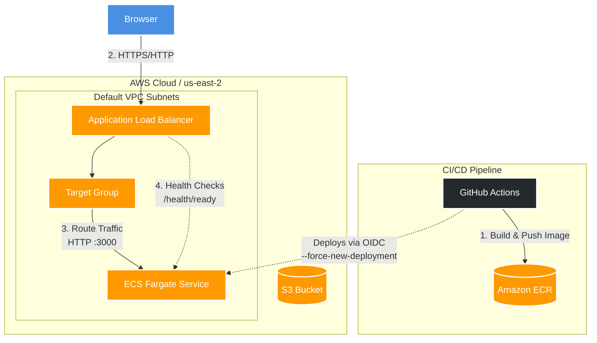

# Pearl Node Service

A small Express service used to demonstrate a repeatable container build and AWS deployment workflow. The application is intentionally compact; the engineering focus is health checks, runtime behavior, container security, and delivery automation.

## Architecture


```text
Terraform provisions the ECR repository, S3 bucket, VPC/networking,
security groups, Application Load Balancer, ECS cluster, task and service.
```

## Service endpoints

| Path | Purpose |
| --- | --- |
| `/` | Demo landing page describing the deployment |
| `/api/v1/info` | Service name, version, runtime, start time and uptime |
| `/health/live` | Process liveness probe |
| `/health/ready` | Readiness probe for the load balancer and container |

Docker and ECS run the same `src/healthcheck.js` probe. It requests `/health/ready` with a short timeout and exits non-zero if the endpoint is unavailable. Set `HEALTH_CHECK_URL` to override the default URL, or run it locally with `npm run healthcheck` while the service is up.

Operational behavior includes bounded JSON request parsing, request IDs, structured request/error logs, safe error responses, basic security headers, graceful `SIGTERM`/`SIGINT` shutdown, and a non-root container user.

## Run locally

Requirements: Node.js 20 or newer and npm.

```sh
npm ci
npm test
npm start
```

Open <http://localhost:3000>. Set `PORT` to change the listen port. `APP_VERSION` can override the version returned from `/api/v1/info`. `TRUST_PROXY=true` enables one trusted proxy hop and should only be used when the service is reachable exclusively through that proxy.

Build and run the container:

```sh
docker build -t pearl-node-service .
docker run --rm -p 3000:3000 pearl-node-service
```

## AWS deployment

The Terraform configuration is under `terraform/` and targets AWS `us-east-2`. It uses an existing S3 bucket for Terraform state, while creating a separate application bucket. Terraform also creates the ECS task execution role. The first deployment is staged because ECS must be able to pull the application image from ECR before the service starts.

### Prerequisites

- AWS CLI configured for the account and region where you want to deploy.
- Terraform installed.
- Docker installed and running.
- Permission to create ECR, S3, IAM, VPC security groups, an Application Load Balancer, and ECS resources.

Check which AWS account the CLI will use:

```sh
aws sts get-caller-identity
```

The backend in `terraform/backend.tf` expects the S3 state bucket `pearlbucket00` to exist in `us-east-2` before `terraform init`. If it does not exist or you do not own it, create a globally unique bucket and update `backend.tf` first. The bucket must exist before initialization because Terraform stores state there. [HashiCorp S3 backend documentation](https://developer.hashicorp.com/terraform/language/backend/s3)

### Initialize Terraform and create ECR

From the repository root:

```sh
cd terraform
terraform init
terraform validate
```

Get the account’s ECR registry URI and create the repository. The trailing slash in the variable value is required by the image URL assembled in `main.tf`:

```sh
AWS_ACCOUNT_ID=$(aws sts get-caller-identity --query Account --output text)
ECR_REGISTRY="${AWS_ACCOUNT_ID}.dkr.ecr.us-east-2.amazonaws.com"
terraform apply -target=module.ecrRepo -var="docker_ecr_uri=${ECR_REGISTRY}/"
```

This targeted apply is only the image-repository bootstrap step. Review Terraform’s proposed changes before approving the apply.

### Build and push the first image

From the repository root (one level above `terraform/`):

```sh
cd ..
aws ecr get-login-password --region us-east-2 \
  | docker login --username AWS --password-stdin "$ECR_REGISTRY"
docker build -t pearl-ecr-repo:latest .
docker tag pearl-ecr-repo:latest "$ECR_REGISTRY/pearl-ecr-repo:latest"
docker push "$ECR_REGISTRY/pearl-ecr-repo:latest"
```

### Plan and create the infrastructure

Return to the Terraform directory, review the complete plan, then apply that saved plan:

```sh
cd terraform
terraform plan -var="docker_ecr_uri=${ECR_REGISTRY}/" -out=terraform.tfplan
terraform apply terraform.tfplan
```

Terraform provisions an internet-facing load balancer that listens on HTTP port `3000`, ECS Fargate tasks with public IP assignment, the ECR repository, networking rules, and an application S3 bucket. These settings are for the demo; review ingress, TLS, network placement, IAM, names, and AWS costs before using it beyond a demo. The ALB health check uses `/health/ready`; AWS requires the target to be registered and reachable on its listener and health-check ports. [AWS ALB health check documentation](https://docs.aws.amazon.com/elasticloadbalancing/latest/application/target-group-health-checks.html)

Get the URL and check the service:

```sh
terraform output -raw application_url
curl "$(terraform output -raw application_url)/health/ready"
```

The initial ECR image needs to be pushed before the full apply. The GitHub Actions workflow can publish subsequent images and trigger ECS deployments once its `production` environment secrets and OIDC role are configured. ECS uses a task execution role to pull the image from ECR. [AWS ECS task execution role documentation](https://docs.aws.amazon.com/AmazonECS/latest/developerguide/task-iam-roles.html)

The GitHub Actions workflow runs `npm test` for pull requests. A push to `main` or `master`, or a manual dispatch, builds an image, pushes a commit SHA tag and `latest` to ECR, then asks ECS to roll out the new image and waits for service stability.

Configure these GitHub Actions environment secrets:

| Secret | Value |
| --- | --- |
| `AWS_ROLE_ARN` | IAM role configured for GitHub Actions OIDC federation |
| `AWS_REGION` | AWS region containing the ECR repository and ECS service |
| `ECR_REPOSITORY_NAME` | Existing ECR repository name |
| `ECS_CLUSTER` | ECS cluster name |
| `ECS_SERVICE` | ECS service name |

Use an IAM role trust policy restricted to this repository and branch/environment. Grant only the permissions needed to push to the target ECR repository and update/describe the specified ECS service. The Terraform task definition currently uses the `latest` image tag, which is why the workflow deploys with `--force-new-deployment` after publishing it.

## Project limitations

- The service has no database or persistent application data.
- Readiness currently reflects process availability only; add dependency checks if external dependencies are introduced.
- The deployment workflow expects the AWS infrastructure and OIDC role to exist already; it does not apply Terraform.
- Review and adapt Terraform defaults, state storage, IAM, ingress, and public subnet choices before using this as a real production service.
