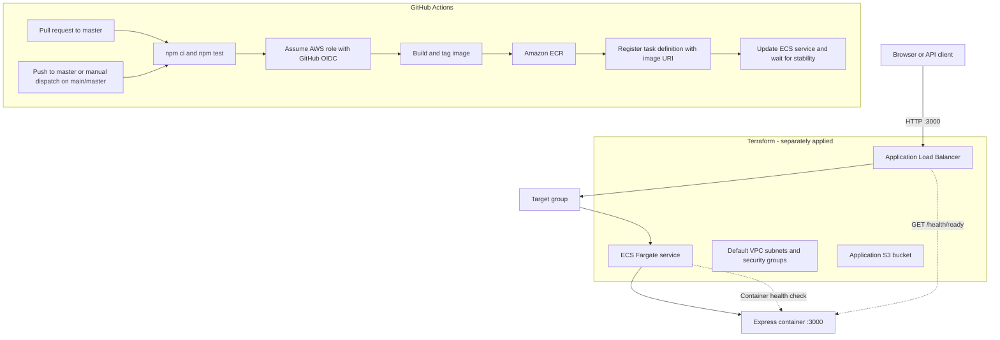

# Architecture

Pearl Node Service is a small Express service running in ECS Fargate. The load balancer routes HTTP traffic to healthy tasks. Terraform describes the AWS resources; GitHub Actions tests and delivers application images. Terraform provisioning is performed separately from the application release workflow.

## Runtime and delivery overview

## AWS components

- **Application Load Balancer:** exposes the demo over HTTP on port `3000` and routes to the target group.
- **ECS Fargate:** runs the Express container with an ECS task health check against `/health/ready`.
- **Amazon ECR:** stores the container image. The workflow tags each image with the commit SHA, workflow run ID, and attempt number.
- **Terraform:** describes the ECR repository, network/security groups, load balancer, ECS cluster/task/service, and application S3 bucket. The S3 backend bucket used for Terraform state must exist before `terraform init`.
- **GitHub Actions:** tests pull requests to `master`. A push to `master` or manual dispatch on `main`/`master` can run the deployment job, which authenticates to AWS through OIDC and deploys the image through a new task definition revision.

## Network and demo boundaries

The checked-in Terraform uses the account's default VPC subnets, assigns public IPs to Fargate tasks, and configures an internet-facing HTTP load balancer. The demo does not configure TLS, a private subnet topology, or a database. Review these choices before adapting the example for production use.
